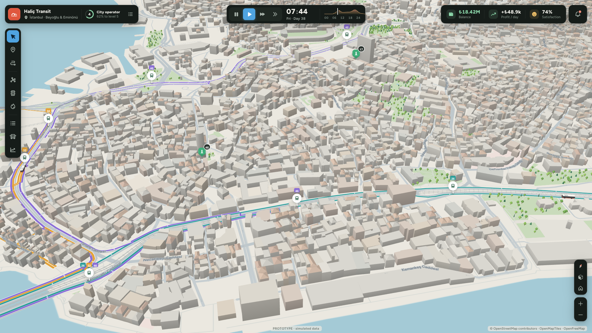

# Project Transit

A single-player desktop game about running a bus company in a real city. You pick a place anywhere in the world, found a company, and build depots, stops and lines on the real street network. Then you buy buses, set timetables, and watch passengers use your service in a miniature 3D model of the city. Fares pay the bills; drivers, fuel, maintenance and depots cost money. Good service earns reputation, and reputation and money unlock new areas of the city.



## Run it

Requirements: Node 22+ and pnpm. The desktop app also needs Rust (stable) and, on macOS, the Xcode command-line tools.

```sh
pnpm install

pnpm dev          # browser: http://localhost:5173
pnpm app          # desktop window (Tauri v2), with hot reload
pnpm app:build    # release build -> src-tauri/target/release/bundle/macos/Project Transit.app (+ .dmg)
pnpm test         # game-core tests (vitest)
```

`pnpm app` starts its own Vite server on port 5173, so stop any running `pnpm dev` first.

İstanbul works offline: its map tiles ship with the app. Other places download OpenStreetMap vector tiles from OpenFreeMap (free, no key) and cache them locally.

## How to play

1. **New company.**
   - Choose a starting city (İstanbul, Durham, Barcelona, Hamburg, Tokyo), search for any town, or start at the current map view.
   - Pick your home area, which is your first operating licence, then a name, colour and logo.
2. **Build a depot** (depot tool, ⇧D). Buses park and are serviced there.
3. **Buy buses** (Fleet → Buy, G). There are six models, from a cheap minibus to an articulated bus. Larger and electric models unlock with reputation.
4. **Draw a line** (line tool, R). Click streets in order to place stops; existing stops work too. The line follows real streets and one-way rules. Shift-click the line to force it along a street. Choose two-way or loop, and optionally a custom return route. Warnings point out long one-way detours.
5. **Assign buses and set the timetable.** Open the line and assign spare buses. The timetable editor shows how many buses each frequency needs.
6. **Run time.** Space pauses; keys 1–4 set the speed (the fastest is about 2 minutes per day).
   - Click a bus to see its passengers and next stops, and press F to follow it.
   - Click a stop for its LED arrival board, predicted from the simulation.
7. **Manage the company.**
   - **Finances (M):** daily results, per-line profit, the ledger, loans and the fare.
   - **Company (C):** objectives and territory.
   - **Satisfaction:** the popover in the top bar explains what passengers dislike most.
8. **Expand.** Licence a neighbouring area (overlay O, or click an area) once you have the reputation and money. Overdraw for too long and the company becomes insolvent, then bankrupt.

The optional first-steps guide walks through steps 2–6, and you can hide it. The game autosaves; ⌘S / Ctrl+S saves now; Esc opens the game menu (save, load, settings, quit).

### Controls

| Key | Action |
|---|---|
| V / B / R / ⇧D | select / stop / line / depot tool |
| Space, 1–4 | pause, speed |
| N / T / P / O | network view, traffic, demand, operating areas |
| L / G / M / C | lines, fleet, finances, company |
| ⌘Z / ⇧⌘Z | undo / redo while drawing a line (right-click also undoes) |
| WASD, Q/E, H | pan, rotate, go home |
| F11 / F10 | fullscreen / hide the interface |
| Esc | step back: tool → follow → selection → panel → game menu |

## What is real, estimated and simulated

**Real (OpenStreetMap):**
- streets, one-way rules, road classes, bridges and tunnels;
- building footprints, water, parks, rail;
- place and street names;
- existing bus stops (shown as suggestions);
- points of interest such as universities, hospitals, stations and malls.

**Estimated, and labelled as estimates in the game:**
- **Residents and jobs:** estimated from building floor area and land use.
- **Building heights:** inferred where OSM has none, which is most buildings.
- **Operating areas:** generated around OSM place names. They are game areas, not official boundaries.

**Simulated:**
- **Traffic:** a time-of-day model by road class and local density. It is not live data, and the legend says so.
- **Passengers:** generated from the estimated demand, choosing the bus over walking or driving by time, price, crowding and reliability. They are modelled as groups, not tens of thousands of individuals.
- **Money:** all prices and costs are game-balance values, documented in [`docs/economy.md`](docs/economy.md). They are shown in local currency using a fixed game factor, not live exchange rates.

There is no online account, no multiplayer and no paid service.

## How it is built

- **Tauri v2, React 19, TypeScript and Vite.** UI state lives in Zustand.
- **The game core** (`src/game/`) is plain TypeScript, independent of React and the renderer.
  - A fixed 1-second simulation step. The renderer interpolates between ticks.
  - Commands return results with explanations; every state change goes through them.
  - **World** (`world/`):
    - the region builder turns vector tiles into a routable road graph (`regionBuilder.ts`, `graph.ts`), plus demand grid, areas and points of interest;
    - simulated traffic (`traffic.ts`).
  - **Network and vehicles:**
    - lines, stops and patterns (`network.ts`);
    - the vehicle state machine (`vehicles.ts`);
    - timetables (`timetable.ts`);
    - ETAs (`eta.ts`).
  - **Passengers and money:**
    - passengers (`passengers.ts`);
    - an event ledger (`finance.ts`);
    - reputation, objectives and territory (`progress.ts`).
- **The app shell** (`src/app/`):
  - session phases (menu, loading, setup, playing);
  - the region worker (tile download, cache, build);
  - saves: Tauri commands with atomic writes and a backup on desktop (`src-tauri/src/saves.rs`), IndexedDB in the browser. Saves are versioned and migrated.
- **The map** (`src/map/`):
  - MapLibre GL draws the base map;
  - a Three.js custom layer draws the miniature city and buses (`cityLayer.ts`, `cityWorker.ts`, `vehicles3d.ts`);
  - GeoJSON overlays draw lines, traffic, demand, areas and the line draft (`overlays.ts`);
  - HTML markers draw stops and depots (`markers.ts`).
- **The HUD** (`src/ui/`) is styled by `src/styles/tokens.css` and `ui.css`, with feature sheets alongside. Design docs are in `docs/design/`.

## Testing

| Command | What it checks |
|---|---|
| `pnpm test` | Game-core tests against real İstanbul data: road connectivity and one-way routing, route validity, timetables, capacity, ETAs, traffic, ledger reconciliation, territory, save/load determinism and migration, balance, a 40-day progression run by a scripted player, a 70-bus performance budget, and regressions. |
| `pnpm play` | End-to-end play-through in Chromium with real clicks: new company → depot → buy → draw a line → assign → run → save → quit → continue (needs `pnpm dev`). Pass an output folder and a size: `node scripts/play.mjs out 1920 1080`. |
| `pnpm shots` | Screenshots of 16 screens of the real game at 1920×1080, 2560×1440 and 1366×768 into `docs/screenshots/` (needs `pnpm dev`). `PRESET=1` starts in another city. |
| `node scripts/dev/webkit-play.mjs out` | Plays, saves, reloads and continues in WebKit, the engine behind Tauri's macOS window (needs `pnpm build && pnpm preview --port 4173`). |
| `scripts/dev/native-saves.sh out` | Save round trip in the real desktop app across three launches: save, close the window, reopen and load, quit (⌘Q path), reopen and load, delete the test saves. Build first with `pnpm tauri build --bundles app`. Works with the screen locked. |
| `node scripts/dev/scene.mjs out 1 8` | Builds a running network in a preset city (index 1 = Durham) at a given hour and captures close-up, line, traffic and demand views. |
| `pnpm check:webkit` | Loads the production build in WebKit and saves a screenshot. |

For a native-window check, launch the built app with `open -n --env PT_DIAG_DIR=/some/folder "Project Transit.app"`. It writes a render report and a PNG of the map canvas. The window only draws while the Mac is unlocked.

Progress against the development milestones is tracked in [`docs/development-progress.md`](docs/development-progress.md).

## Data and attribution

Map data © [OpenStreetMap contributors](https://www.openstreetmap.org/copyright) (ODbL). Tiles from [OpenMapTiles](https://openmaptiles.org/), served by [OpenFreeMap](https://openfreemap.org/). Place search uses [Nominatim](https://nominatim.org/), only when you press Enter. Attribution is shown on the map at all times.

The UI font is Figtree (SIL Open Font License), and the icons are Phosphor (MIT). All art is original: the buses, markers, logos and illustrations are drawn in code.
